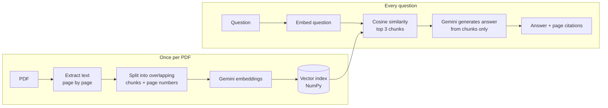

# DocuChat

**An AI chatbot that answers questions from any PDF, using Retrieval-Augmented Generation (RAG).**

Upload a PDF (an FAQ, a policy, a price list, a job description) and ask questions in plain English. DocuChat finds the relevant passages, answers **only** from the document, and shows which page each answer came from. If the answer isn't in the document, it says so instead of guessing.

**Live demo:** _coming soon_


---

## Features

- **Answers grounded in your document.** The model is instructed to use only the retrieved text, which reduces hallucination.
- **Page citations.** Every answer shows the source pages; hover over a page chip to see the exact passage.
- **Honest fallback.** Questions the document can't answer get a polite "I don't have that information" instead of a made-up reply.
- **Semantic search.** Matches meaning, not keywords ("Can I get my money back?" finds the refund policy).
- **Upload any text-based PDF.** The bot switches to the new document instantly.
- **Clean, mobile-friendly chat UI.** Brand colour is a single CSS variable, so it can be re-themed for any business.

## How it works



1. **Load:** `pypdf` extracts text from each page and keeps the page number as metadata.
2. **Chunk:** each page is split into 100-word chunks with a 20-word overlap, so sentences cut at a boundary still appear whole in one chunk.
3. **Embed:** each chunk becomes a 3072-dimension vector using Gemini embeddings (`RETRIEVAL_DOCUMENT` task type), sent in batches of 100.
4. **Retrieve:** the question is embedded (`RETRIEVAL_QUERY` task type) and compared to every chunk with cosine similarity; the top 3 chunks are kept.
5. **Generate:** Gemini answers using only those chunks, guided by a system instruction that enforces grounding, short answers, page citations and the fallback message. Temperature is 0.2 for consistent, factual replies.

## Tech stack

| Layer | Tools |
|---|---|
| LLM and embeddings | Google Gemini API (`google-genai` SDK) |
| Retrieval | NumPy (normalized vectors, dot-product similarity) |
| PDF parsing | pypdf |
| Backend | FastAPI, Uvicorn, Pydantic |
| Frontend | HTML, CSS, vanilla JavaScript (`fetch`, `FormData`) |

## Project structure

```
docuchat/
├── app.py               # FastAPI server: /, /status, /upload, /chat
├── rag.py               # RAG pipeline: load, chunk, embed, search, answer
├── static/
│   └── index.html       # Chat UI
├── brightpath_faq.pdf   # Sample document (fictional coaching institute)
├── requirements.txt
├── .env                 # Your API key (not committed)
└── .gitignore
```

## Run it locally

**1. Clone and set up**

```bash
git clone https://github.com/Raman19-code/Docuchat.git
cd Docuchat
python -m venv venv
venv\Scripts\activate          # Windows
# source venv/bin/activate     # Mac/Linux
pip install -r requirements.txt
```

**2. Add your Gemini API key**

Get a free key from [Google AI Studio](https://aistudio.google.com), then create a `.env` file:

```
GEMINI_API_KEY=your_key_here
CHAT_MODEL=gemini-2.5-flash
EMBED_MODEL=gemini-embedding-001
```

If a model name stops working, replace it with the current one from the [Gemini models list](https://ai.google.dev/gemini-api/docs/models).

**3. Start the server**

```bash
python app.py
```

Open **http://127.0.0.1:8000** to chat, or **http://127.0.0.1:8000/docs** for interactive API documentation.

You can also chat in the terminal with `python rag.py`.

## API

| Method | Endpoint | Description |
|---|---|---|
| `GET` | `/` | Chat web page |
| `GET` | `/status` | Name of the loaded document and its chunk count |
| `POST` | `/upload` | Upload a PDF (multipart form field `file`) and index it |
| `POST` | `/chat` | Body `{"question": "..."}` → `{"answer": "...", "sources": [{"page", "score", "text"}]}` |

## Design decisions

- **Page-level chunking with overlap** keeps citations accurate and avoids losing sentences at chunk boundaries.
- **Separate task types** for document and query embeddings improve matching between questions and answer passages.
- **Normalized vectors** turn cosine similarity into a single matrix multiplication across all chunks.
- **System instruction for rules, user message for context** keeps the bot's behaviour consistent and harder to override.
- **Sync endpoints (`def`)** because the Gemini SDK calls are blocking; FastAPI runs them in a thread pool so one slow request doesn't block others.
- **`textContent` in the UI** so text from a PDF can never run as HTML or script (XSS protection).

## Limitations and next steps

- The index lives in memory: it resets on restart and all visitors share one document. Next step: a vector database (FAISS or Chroma) with a separate index per user or client.
- Scanned (image-only) PDFs have no extractable text. Next step: OCR.
- One document at a time. Next step: multi-document collections.
- No conversation memory, so follow-up questions like "and the NEET one?" lack context. Next step: include recent chat history in retrieval.
- Next step: an embeddable chat widget so a business can add the bot to its own website with one script tag.

## Author

**Ramandeep Kaur** · B.E. CSE (AI & ML), Chandigarh University
[GitHub](https://github.com/Raman19-code)
